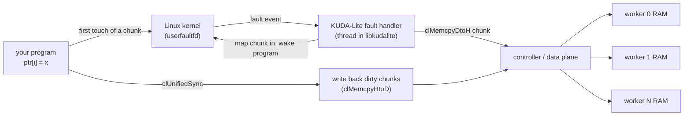

<!--
Copyright 2026 Christopher Hinds, Stratum Labs llc
SPDX-License-Identifier: Apache-2.0 (see the LICENSE file at the project root)
-->

# Unified Memory View

An **optional** feature, added in 0.4 (`clUnifiedDiscard` in 0.4.1) and off by default. It lets a program on the controller, or on any Linux host, see the RAM of **every worker** as **one continuous address range** that ordinary pointers can read and write:

```cpp
clUnifiedView_t view;
clUnifiedOpen(&view, 0, 0);       // 0 = as much cluster memory as possible
clUnifiedInfo info;
clUnifiedGetInfo(view, &info);
float* all = static_cast<float*>(info.base);   // e.g. 150 GB spanning 4 Orange Pi 6 Plus workers
all[0] = 1.0f;                                  // worker 0's RAM
all[info.bytes / sizeof(float) - 1] = 2.0f;     // the last worker's RAM
clUnifiedSync(view);                            // writes reach the workers
```

It works on both platforms (Raspberry Pi 5, Orange Pi 6 Plus) and in mixed clusters, uses the existing network, and needs **no custom kernel driver and no root**.

## 1. Enabling it

| Where | How |
|---|---|
| CMake | `-DKUDALITE_UNIFIED_MEMORY=ON`, or the `unified` preset: `cmake --preset unified && cmake --build --preset unified` |
| Deployment | `sudo deploy/install.sh <role> --unified-memory`, or for a whole cluster `deploy/deploy-cluster.sh -x "--unified-memory" install` |
| Your CMake project | `find_package(kudalite 0.4)` sets `KUDALITE_UNIFIED_MEMORY` to `ON` or `OFF` for the installed library |

When the library is built **without** the option, the `clUnified*` functions still exist and return `clErrorNotSupported`, so applications can check for the feature at runtime.

**Requirements** (on the machine running your program; workers need nothing):

| Requirement | Why |
|---|---|
| Linux (any distribution), kernel headers at build time | Uses `userfaultfd`. macOS hosts can't use the view; the rest of KUDA-Lite works there unchanged. |
| Kernel ≥ 5.11 (Raspberry Pi OS, Ubuntu 22.04+, Orange Pi Debian 12 with 6.6 all qualify) | Unprivileged `userfaultfd` in "user-mode only" mode works with the default `vm.unprivileged_userfaultfd = 0`. On older kernels, run as root or set that sysctl to 1. |
| Kernel ≥ 5.7 for write tracking | Only modified chunks are written back. Without it the view still works, but each sync writes back every resident chunk. |

## 2. How it works



1. `clUnifiedOpen` allocates cluster memory with the **blocked** distribution: one contiguous slice per worker, laid back to back. It reserves an equally sized window of virtual address space in your process and registers it with `userfaultfd`.
2. The **first touch** of each chunk (default 256 KiB) stops the touching thread. A handler thread fetches that chunk from the worker that owns it, maps it in and lets the thread continue. Later accesses to the chunk run at normal memory speed.
3. Chunks loaded by a **read** are mapped write-protected. The **first write** to them raises a cheap local fault that marks the chunk dirty. Nothing goes over the network for that.
4. `clUnifiedSync` re-protects the dirty chunks and copies them back to their workers. Re-protecting *before* copying means a write that lands during the sync is caught by the next one.
5. `clUnifiedInvalidate` syncs, then drops every local copy so the next access fetches fresh data.
6. `clUnifiedDiscard` marks whole chunks as "about to be overwritten". Their next touch maps a zero-filled chunk, already dirty, **without fetching anything**, and the next sync writes it back. Filling a window with new data then crosses the network once instead of twice.

**Layout.** The window is one KUDA-Lite allocation (`info.devPtr`), so it is also an ordinary device pointer: kernels, `clMemcpy*` and `clMemset` work on it directly. Worker slices follow each other in the order the controller assigns. Every address belongs to exactly one worker, and the window has no gaps.

**Transport.** The fault handler moves data with the normal host runtime (`clMemcpyDtoH` / `clMemcpyHtoD`). Whatever data path KUDA-Lite uses is used here too: 1 GbE on the Pi 5, 5 GbE on the Orange Pi 6 Plus, and any faster link added in future (§8).

## 3. API

| Function | Purpose |
|---|---|
| `clUnifiedOpen(&view, bytes, chunkBytes)` | Open a window of `bytes` (0 = the largest the cluster can provide: up to 95 % of the smallest worker's free arena on every worker). `chunkBytes` 0 = 256 KiB; must be a multiple of the page size (4 KiB, or 16 KiB on some Pi 5 kernels). |
| `clUnifiedGetInfo(view, &info)` | Window address (`base`), device pointer (`devPtr`), size, chunk size, worker count, whether write tracking is on, and statistics: resident and dirty bytes, faults, bytes fetched, written back, and zero-filled by discard (`bytesDiscarded`). |
| `clUnifiedSync(view)` | **Release:** push modified chunks to the workers. Also returns any fetch error since the last sync (§6). |
| `clUnifiedInvalidate(view)` | **Acquire:** sync, then drop local copies, so data written elsewhere (kernels, other processes, `clMemcpyHtoD`) becomes visible. |
| `clUnifiedPrefetch(view, offset, bytes)` | Fetch a range now: before system calls (§6), or to avoid fault latency in a time-critical section. |
| `clUnifiedDiscard(view, offset, bytes)` | Declare that you will **overwrite** the range without reading it. Every chunk entirely inside the range is dropped (unsynced changes in it are lost) and comes back zero-filled, not fetched, on its next touch. Partly covered chunks at the ends are left alone. `clUnifiedInvalidate` cancels a pending discard. Use it before filling a window with new data. |
| `clUnifiedClose(view)` | Sync, unmap, and free the cluster memory. |

A complete example is in [`examples/unified_memory.cpp`](../examples/unified_memory.cpp).

## 4. Consistency rules

The view follows KUDA-Lite's release/acquire model ([MEMORY_MODEL.md §5](MEMORY_MODEL.md#5-consistency-model)):

| You want to… | Do this |
|---|---|
| Let a kernel (or `clMemcpyDtoH`, or another process) see what you wrote through the pointer | `clUnifiedSync`, then launch or copy |
| See through the pointer what a kernel (or `clMemcpyHtoD`, or another process) wrote | wait for it (`clStreamSynchronize`), then `clUnifiedInvalidate` |
| Fill a range with new data, ignoring what is there | `clUnifiedDiscard` the range, write it, then `clUnifiedSync` |
| Share a window between threads of one process | Just use it. The handler is thread-safe, and threads see each other's writes as normal memory. |

- **Two processes** each opening their own view get **separate** windows over separate allocations. To share data, use the device pointer or the usual KUDA-Lite APIs.
- **Concurrent writers** to the same bytes from different places (a kernel and the pointer, at the same time) have no defined winner, exactly as in the rest of KUDA-Lite.
- `clMemcpyDtoH` **into** the window is safe. The runtime loads and unprotects the destination chunks before the copy, so no deadlock is possible.

## 5. Performance

Each **first touch** of a chunk costs one network round trip plus the chunk transfer. Estimates for 256 KiB chunks:

| Cluster | Per-chunk first touch | Streaming a 1 GiB array for the first time |
|---|---|---|
| Raspberry Pi 5 (1 GbE) | ≈ 2.5–3 ms | ≈ 10 s (network-bound, ≈ 110 MB/s) |
| Orange Pi 6 Plus (5 GbE) | ≈ 0.5–0.7 ms | ≈ 2 s (≈ 550 MB/s) |
| After the first touch | memory speed | memory speed |

These are estimates; measure on your cluster. Guidance:

- **Good fits:** large arrays processed sequentially or in big blocks; data read many times after loading; preparing inputs for kernels and reading their results.
- **Poor fits:** small random accesses scattered across a huge window. Each touches a new chunk and pays a full round trip. Use kernels, or `clMemcpy*` in batches, for those.
- **Writing new data:** without a hint, the first write to a chunk fetches it first (the view can't know you will overwrite all of it), so filling a window costs **twice** the traffic of `clMemcpyHtoD`. Call `clUnifiedDiscard` on the range first to avoid the fetch.
- **Chunk size:** bigger chunks (1–4 MiB) suit streaming; smaller ones (64 KiB) suit sparse access. Use `clUnifiedPrefetch` to load a region in one batch before working on it.
- Resident chunks use local RAM in your process. A window larger than the host's RAM works as long as you don't keep it all resident at once (`clUnifiedInvalidate` releases it).

### Measured: unified view vs. explicit copies

The same host-side work done both ways: the original design (`clMemcpyHtoD` / `clMemcpyDtoH` with a host buffer) and the unified pointer. 192 MiB array, 256 KiB chunks, local 3-worker cluster over loopback, three runs each, measured with `cl-bench-unified`. Loopback times are mostly CPU and protocol overhead, so the **data moved** column is what carries over to a real network; the last column estimates a Raspberry Pi 5 cluster (1 GbE, ≈ 110 MB/s, ≈ 0.25 ms per round trip).

| Task | Explicit copies | Unified view | Estimate on 1 GbE (explicit → unified) |
|---|---|---|---|
| Write a whole array, push it to the workers | 192 MiB, 0.4–0.66 s | 384 MiB, 1.1–1.8 s (2.5–3.9×) | 1.8 s → 3.7 s |
| …with `clUnifiedDiscard` first | | **192 MiB, 0.55–0.71 s (0.9–1.8×)** | 1.8 s → **≈ 1.8 s** |
| Kernel on the workers (saxpy) | ≈ 110 ms | ≈ 110 ms (same) | same: kernels never go through the view |
| Read a whole result array, on-demand faults | 192 MiB, 0.62–0.66 s | 192 MiB, 0.86–0.98 s (1.3–1.7×) | 1.8 s → ≈ 2 s (one round trip per chunk) |
| …with `clUnifiedPrefetch` first | | 192 MiB, 0.65–0.83 s (1.0–1.4×) | ≈ 1.8 s → ≈ 1.8 s |
| Read 2,000 random values | 8 KB in 2,000 small copies, 0.7 s | 179 MiB (one chunk per value), 0.65–0.9 s | 0.5 s → **1.6 s** (worse) |
| Change 100 scattered values, push | 192 MiB (whole array), 0.24–0.36 s | 25 MiB (100 chunks), 55 ms (≈ 6× faster) | 1.8 s → **0.25 s** (better) |
| …vs. 100 tiny explicit copies | 400 B, 15–86 ms | 25 MiB, 55–60 ms | 25 ms → 0.25 s (worse) |

In short: the view does **not** make kernels or the cluster faster; it makes host code simpler (one pointer, no host copy of the data, windows larger than host RAM). Bulk reads cost about the same, bulk writes cost the same **with `clUnifiedDiscard`**, sparse updates of a large array are cheaper, and scattered single-value reads are dearer. Rerun it on your cluster with `cl-bench-unified [--controller HOST] [--mib N] [--chunk-kib N] [--runs N]` (installed with the option; acceptance test U3 in [TESTING.md](TESTING.md#4-hardware-acceptance-plan)).

## 6. Limitations

| Limitation | What to do |
|---|---|
| **System calls on chunks not yet loaded fail with `EFAULT`** (e.g. `write(fd, ptr, n)`): unprivileged `userfaultfd` only handles faults from user code, not from the kernel | Touch or `clUnifiedPrefetch` the range first (tested) |
| If a fetch fails (e.g. a worker died), the faulting access cannot be failed from inside the handler: the chunk is **zero-filled**, a message is printed, and the **next `clUnifiedSync` returns the error** | Check `clUnifiedSync`'s result before trusting data; worker loss loses that data anyway ([ARCHITECTURE.md §10](ARCHITECTURE.md#10-failure-model)) |
| `fork()` while a view is open is not supported (the child has no fault handler) | Open views after forking, or use `posix_spawn` |
| The window size is fixed at open | Open a new view to resize |
| Transparent huge pages are disabled for the window | None needed; the chunk is the unit |
| Linux hosts only | macOS programs use the regular API |

## 7. Why not GPIO

The original request was a **GPIO-based interface with a custom driver** that would make all workers' RAM appear as one memory to the controller. That was analysed before implementation, and this software view was chosen instead:

1. **GPIO can't be memory-mapped as RAM.** For the CPU's ordinary loads and stores to reach another board's memory, they must travel over a memory bus the CPU understands, such as PCIe with a non-transparent bridge, or CXL. GPIO pins are driven by software, one transfer at a time. A GPIO link could only *emulate* shared memory in software, exactly as this feature does over the network.
2. **GPIO is much slower than the existing network.** The fastest measured Raspberry Pi 5 GPIO path (its programmable I/O block, fed by DMA) is about **10–20 MB/s**, and direct register toggling reaches only about 20 MHz. The Pi 5's 1 GbE gives about 110 MB/s and the Orange Pi 6 Plus's 5 GbE about 550 MB/s. A GPIO transport would make the view **5–50× slower**.
3. **It doesn't scale.** The controller has one 40-pin header with roughly 26 usable lines. Linking several workers needs custom wiring and buffering, and signal integrity limits speed over cables. The Orange Pi 6 Plus has no equivalent of the Pi 5's programmable I/O block.
4. **True hardware shared memory isn't available on these boards.** The Pi 5 exposes one PCIe Gen 2 ×1 lane in root-complex mode only, and no Pi-compatible non-transparent-bridge hardware or driver was found. It would take custom FPGA or PCIe-switch hardware.

So the view is built on a **transport-independent mechanism** (page faults handled in user space). If faster hardware appears, such as a PCIe/NTB or FPGA interconnect, it plugs in as a KUDA-Lite data-plane transport, and the view uses it without changes ([ROADMAP.md](ROADMAP.md)).

## 8. Testing

`cl-test-unified` (built and installed with the option, and run by the integration test) checks:

- the window spans every worker, and closing it returns the memory;
- pointer writes reach the workers, and device writes are visible after invalidate;
- kernels and pointers share the memory (`saxpy`);
- only modified chunks are written back;
- concurrent threads work;
- system calls work after prefetch;
- `clMemcpyDtoH` into the window doesn't deadlock;
- `clUnifiedDiscard` fills a whole window with **no** bytes fetched, only whole chunks are dropped, unsynced changes in them are discarded, and invalidate cancels a pending discard;
- the "largest possible window" mode works.

The deadlock regression test was confirmed to **hang** when its protection is removed, so it really guards that path. Results are in [TESTING.md](TESTING.md).

## Sources (GPIO analysis)

- Raspberry Pi Forums, [RP1 PIO DMA speed on Raspberry Pi 5 unexpectedly slow](https://forums.raspberrypi.com/viewtopic.php?t=390556); [Pi 5 / RP1 I2S capture (PIO 20+ MB/s)](https://forums.raspberrypi.com/viewtopic.php?t=399956)
- hzeller, [rpi-gpio-dma-demo](https://github.com/hzeller/rpi-gpio-dma-demo): Pi 5 GPIO output ≈ 20 MHz
- Raspberry Pi, [RP1: the silicon controlling Raspberry Pi 5 I/O](https://www.raspberrypi.com/news/rp1-the-silicon-controlling-raspberry-pi-5-i-o-designed-here-at-raspberry-pi/)
- Jeff Geerling, [Testing PCIe on the Raspberry Pi 5](https://www.jeffgeerling.com/blog/2023/testing-pcie-on-raspberry-pi-5/)
- Raspberry Pi Forums, [Communicating multiple CM4 via PCIe](https://forums.raspberrypi.com/viewtopic.php?t=347944): root complex only; NTB needed
- University of Oslo IN5050, [PCI Express non-transparent bridging](https://www.uio.no/studier/emner/matnat/ifi/IN5050/v24/slides/interconnect-in5050.pdf): remote load/store over NTB
